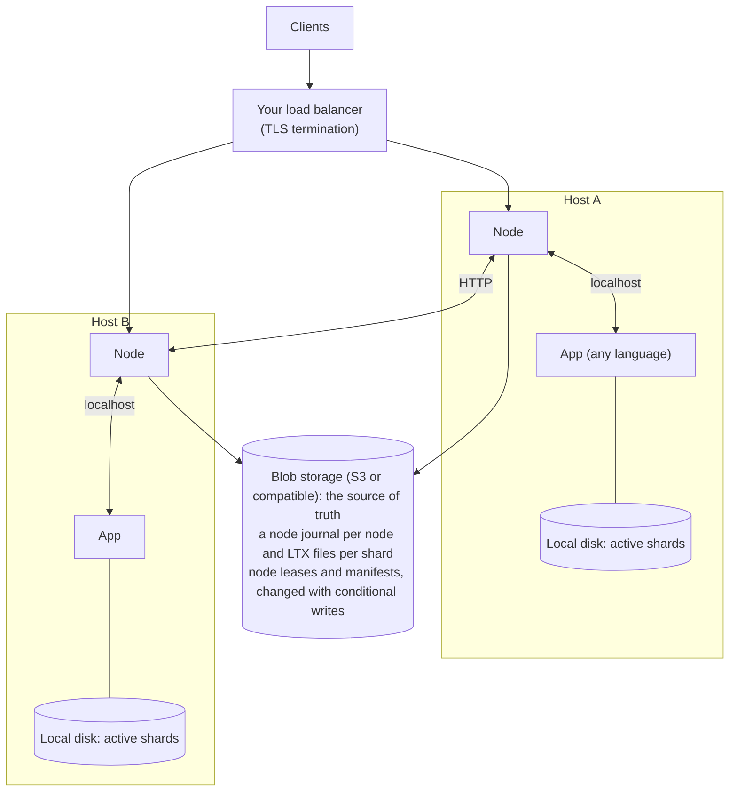

# shardlite
SQLite databases served as virtual actors.

## Goal

Make it easy to scale a game at launch. Game state is split into many small **shards** (a player, a match, a guild, a zone). Each shard is a SQLite database with exactly one writer at a time, living on the node that is serving it. This is sharding taken to the extreme: each player gets their own database, not a row in a players table. Nodes can be added during a launch spike and removed afterwards.

A player shard is like a save file per player, always saved, backed up and shared across servers. Its schema is the save format, and migrations are save-file upgrades. The same shape suits real-time collaboration tools: one shard per document, with every editor's WebSocket on it, and idle documents costing only storage.

This is the Orleans / Durable Objects model, with SQLite as the state and two differences that matter for games: apps can be written in any language or framework (even Unreal dedicated servers), and clients can connect directly to the process holding a shard over UDP or WebRTC, not only through an HTTP proxy.

Shardlite keeps Orleans' operational trade-offs. Blob storage (S3 or compatible) is the source of truth, run by someone else, and the final check against duplicate owners. Nodes keep only working copies of their active shards on local disk, so they are disposable. Shardlite is a router in front of blob storage, not a database to operate.

An actor's state is always its SQLite file, never objects in memory, so activation and deactivation move a file rather than an object graph:

- **Deactivating** is closing the file and one manifest update in storage that records its last changes and gives the shard up. There is nothing to serialise, and the recent changes are already in the node journal.
- **Activating** is claiming the shard and restoring its file from storage, tens of milliseconds for a small shard and longer for a large one. Once it is open, SQLite reads pages lazily, so a request loads only the pages it touches.
- **Memory follows the working set,** not the number or size of actors, so a node can hold far more actors than fit in memory.

The trade-off is that reads go through SQLite (microseconds once the pages are in memory) and anything the app keeps in memory outside SQLite is lost on deactivation. A shard is also not a turn-based actor: requests for the same shard run concurrently, and the app's transactions are the concurrency control, so a handler that reads and then writes does both in one transaction. An app written for Orleans or Durable Objects, which run one turn at a time, loses updates here.

Shardlite's own state about a shard lives in the shard, and anything global only points into it (reminders are rows in the shard's table, and the reminder index holds no payload). So nothing global has to stay consistent with the shards, deleting a shard takes its state with it, and the node's memory is a cache it can lose at any time.

A shardlite app should be no more exposed to abuse than any web app. Clients can name shards directly, which a plain web app never allows, so the node makes naming one cost no more than a request for a row that doesn't exist. What remains is floods (rate limiting at the load balancer) and abuse by authenticated users (the app limits it). A design that lets unauthenticated input cause blob storage writes, restores or state left behind is a gap shardlite opened, and the node closes it. One gap is open: a guessed id of a shard that exists costs a restore before the app can refuse the request, so kinds clients can name should use unguessable ids (see [Kinds clients can name](guide.md#kinds-clients-can-name)).

## Non-goals

- **No queries or transactions across shards.** Anything that needs agreement between shards goes through one shard that owns that agreement (see [Consistency model](#consistency-model)). Unlike Orleans, there are no opt-in distributed transactions.
- No consensus or replication between nodes. Each shard has one writer and blob storage is the source of truth.
- No general-purpose distributed database features (cross-shard indexes, query planning).

## Concepts

| Term | Meaning |
|---|---|
| **Shard** | One SQLite database, identified by `kind/id` (e.g. `users/42`). |
| **Shard kind** | A category of shards (`users`, `zone`) with shared configuration. |
| **Node** | The shardlite process, one per host and shared by the app processes on it. Disposable. |
| **App** | Any process on the host that uses shardlite, in any language. It serves whole kinds. |
| **Owner** | The node allowed to write a shard, for as long as its lease is valid. |
| **Active shard** | A shard that is open on its owner, its working copy on the owner's disk, and shipping changes. Costs memory, CPU and disk. A shard that is not active lives only in blob storage. |
| **Gate** | The node holds a shard's output until the writes before it meet the kind's tier: nothing for `none`, blob storage for `storage` (the default). A tier the node cannot meet fails the answer. |

## Architecture

The node does all of the distributed work: leases, ownership, routing, shipping changes to blob storage, durability gates and moving shards between nodes. The app only opens a local SQLite file with its own driver, on the same kernel as the node.

## Consistency model

One shard has one writer, and every read and write of it is linearizable while its owner holds it. The guide says what each tier promises when the owner is lost (see [Consistency](guide.md#consistency)). Across shards, consistency is the app's problem, and anything needing agreement goes through a shard that owns it: a trade is a `trade/{id}` shard running a saga of idempotent steps, and global data (a name registry, a bracket) lives in a global shard, which is a single point of availability until its owner's lease expires. Shardlite provides no cross-shard locks. For payments, keep the `storage` tier and store them as an append-only ledger keyed by the provider's transaction id.

## Prior art

- HBase and Bigtable: one write-ahead log per server shared by many regions, the closest precedent for node journals.
- Neon: the same split as node journals and snapshots, and generations for fencing.
- Litestream: snapshots plus WAL segments per database, stored as LTX files, which shardlite also stores.
- SlateDB: its fencing of WAL writers by conditional creates is the model for node journals.
- ActorDB: a SQLite database per actor, but queried as a database server, with Raft and cross-actor transactions.
- Durable Objects: SQLite storage with output gates, and alarms, which a shard's reminders follow.
- Pat Helland, "Life beyond Distributed Transactions": entities that change atomically only within themselves and talk through at-least-once messages. Shardlite's model, and what the guide's durable send follows.
- Orleans reminders: durable timers for actors, kept in a table the cluster shares. A shard's reminders are rows in its own table.
- Restate and Akka Persistence: durable messages between stateful objects, journaled elsewhere rather than in each object's database.
