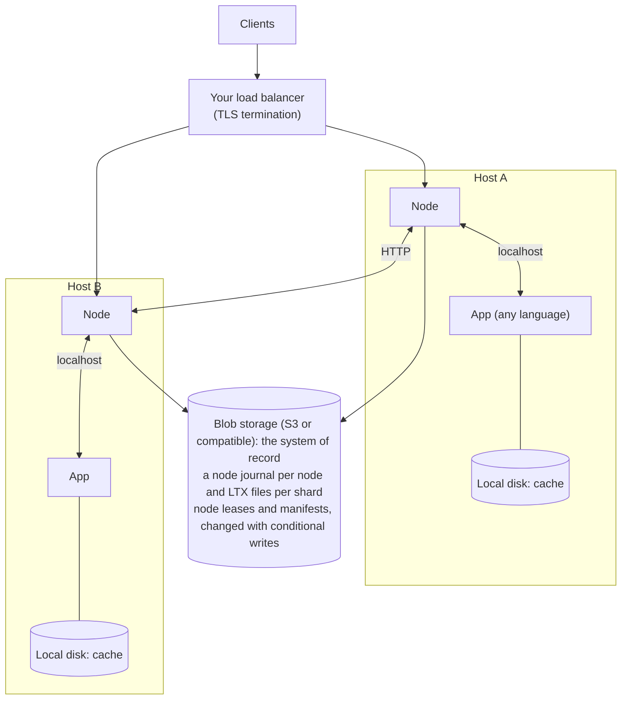

# shardlite

Actors made of SQLite databases, served as virtual actors or pinned to your own servers.

## Goal

Make it easy to scale a game at launch. Game state is split into many small **shards** (a player, a match, a guild, a zone). Each shard is a SQLite database with exactly one writer at a time, living on the node that is serving it. This is sharding taken to the extreme: rather than splitting a players table into a few shards, each player gets their own. Nodes can be added during a launch spike and removed afterwards.

For game teams, a player shard is like a save file per player, always saved, backed up and shared across servers. Its schema is the save format, and migrations are save-file upgrades. Many game teams know that model better than a shared database.

The same shape suits real-time collaboration tools (documents, whiteboards, design files): one shard per document, with every editor's WebSocket on it, its single writer ordering the edits and SQLite holding the document and its history. Idle documents cost only storage.

This is the Orleans / Durable Objects model, with SQLite as the state and with two differences that matter for games:

- Apps can be written in any language or framework, even Unreal dedicated servers.
- Clients can connect directly to the process holding a shard over UDP or WebRTC, not only through an HTTP proxy.

Shardlite keeps Orleans' operational trade-offs. Blob storage (S3 or compatible) is the system of record, run by someone else. Nodes keep shards on local disk only as a cache, so they are disposable. Durability comes from shipping changes to blob storage, and the storage is the final check against duplicate owners (as Orleans' storage ETags are). Shardlite is a router and a cache in front of blob storage, not a database to operate.

An actor's state is always its SQLite file, never objects in memory. That makes activation and deactivation almost free:

- **Deactivating** is closing the file. Its recent changes are already in the node journal, and the node writes them as a snapshot. The data is already a file, so there is nothing to serialise. In Orleans, deactivating means serialising the grain's state and writing it to a storage service.
- **Activating** is opening the file. SQLite reads pages lazily, so a request only loads the pages it touches. Orleans reads and deserialises the whole state before the first call.
- **Memory follows the working set,** not the number or size of actors. Idle shards can deactivate early, and a node can hold far more actors than fit in memory. The OS file cache keeps recently used pages warm, so a shard that comes back quickly is still cheap.

The trade-off is that reads go through SQLite (microseconds from cache) rather than plain objects, and anything the app keeps in memory outside SQLite is lost on deactivation.

The same goes for shardlite's own state about a shard: it lives in the shard, and anything global only points into it. Messages and timers are rows in the shard's own tables, written in the app's transactions, the way an intrusive list keeps its links inside the elements. Where something global is needed, such as the wake hints in blob storage, it holds no payload, just which shard to look at when. So nothing global has to stay consistent with the shards, deleting a shard takes its state with it, and the node's memory is a cache it can lose at any time.

## Non-goals

- **No queries or transactions across shards.** Reading two shards means two separate reads, at your own risk. Anything that needs agreement between shards goes through one shard that owns that agreement (see [Consistency model](#consistency-model)). Unlike Orleans, there are no opt-in distributed transactions.
- No replication between nodes. Each shard has one writer, and blob storage provides durability. Reads that may be stale, from any node, come from snapshot reads instead (later, see the [roadmap](roadmap.md#later)).
- No general-purpose distributed database features (cross-shard indexes, query planning).

## Concepts

| Term | Meaning |
|---|---|
| **Shard** | One SQLite database, identified by `kind/id` (e.g. `users/42`). |
| **Shard kind** | A category of shards (`users`, `zone`) with shared configuration: sync, idle timeout. |
| **Node** | The shardlite process (`shardlited`), one per host (a machine, VM or Kubernetes node) and shared by the app processes on it. Written in Go. Disposable. |
| **App** | Any process on the host that uses shardlite, in any language. It serves whole shard kinds or pins specific shards. |
| **Owner** | The node allowed to write a shard. A node keeps ownership of its active and cached shards while its lease is valid. |
| **Active shard** | A shard that is open on its owner and shipping changes. Costs memory and CPU. |
| **Local cache** | Shard files kept on a node's disk after deactivation. Evictable. Costs disk only. |
| **Pin** | A process's hold on a shard: the node proxies the shard to that process and never hands it off until the process lets go. The process serves its own clients over any protocol. |
| **Gate** | For kinds with sync on, the node holds a shard's output (responses, streams and calls) until the writes before it are in blob storage, as Durable Objects' output gates do and as Orleans code does by awaiting `WriteStateAsync` before returning. |

## Architecture

The node does all of the distributed work: leases, ownership, routing, shipping changes to blob storage, durability gates and moving shards between nodes. The app only opens a local SQLite file with its own driver. The app and node share a local filesystem on one kernel.

## Consistency model

- One shard, one writer. Within a shard, transactions are SQLite's (serializable), and with sync on (the default) every read and write of the shard is linearizable: the guarantee CockroachDB gives for a key, for a whole database. It assumes working clocks (their rates, not their synchronisation), and a request can ask for reads that hold under any clocks and pauses. The levels and their conditions are in [Consistency](guide.md#consistency).
- Across shards, consistency is the app's problem.
- Anything needing agreement goes through a shard that owns it:
  - A trade is a `trade/{id}` shard running a saga: reserve on both player shards, then commit or release, with idempotent steps and resumable state.
  - Shardlite provides no locks across shards. Apps that want them can write them as data in their shards.
  - Global data (name registry, tournament brackets) lives in a global shard. It is single-writer, so very hot global data (leaderboards) should be sharded or aggregated in batches.
  - Global shards are a single point of availability. If their owner crashes, they are unavailable until the lease expires and another node restores them.
- Payments: keep sync on (the default), store payments as an append-only ledger keyed by the provider's transaction id and reconcile against the payment provider.

## Prior art

- HBase and Bigtable: one write-ahead log per server shared by many regions, and log splitting when a server dies. The closest precedent for node journals.
- Neon: the same split as node journals and snapshots (safekeepers for the WAL, image and delta layers in object storage), and generations for fencing page servers.
- Litestream: snapshots plus WAL segments per database, stored as LTX files. Shardlite uses it as a library and shares the WAL across a node's shards.
- BookKeeper: garbage collection of shared logs.
- WarpStream: stateless agents on object storage.
- SlateDB: an LSM tree on object storage. Its fencing of WAL writers by conditional creates is the model for node journals.
- mvsqlite: SQLite pages stored in a key-value store.
- ActorDB: a SQLite database per actor, with a schema per actor type, Raft replication and transactions across actors, queried as a database server rather than opened locally.
- Durable Objects: SQLite storage with output gates. Its alarms are durable timers too, kept in the object's storage and retried with backoff, but one per object, where a shard's inbox holds any number.
- [Durable Actors](https://github.com/TerseAI/durable-actors) (Terse, 2026): an open-source take on Durable Objects. Actors are written in its TypeScript or Python SDK and run inside its runtime, with a Postgres control plane and an LTX chain per actor in object storage. Its `terse-ltx` and `terse-litestream` crates come from it.
- Pat Helland, "Life beyond Distributed Transactions": entities that change atomically only within themselves and talk through at-least-once messages, remembering what each partner has sent. Shardlite's model, almost exactly.
- SQL Server Service Broker: queues as tables inside the database, sent and received in the same transactions as the data, delivered exactly once and in order between databases.
- Akka Persistence's at-least-once delivery: an actor keeps the messages it has sent but not had confirmed in its own persisted state, and sends them again until they are, as a shard keeps its outbox.
- Orleans reminders (and Dapr's and Service Fabric's): durable timers for actors, kept in a table the whole cluster shares rather than in the actor's state. A shard's timers are rows in its own inbox, and the only global part is a wake hint with no payload.
- Restate: virtual objects with durable state, timers and messages between services, journaled in Restate's own log rather than in each object's database.
- Spanner: commit wait, which holds acknowledgements until TrueTime uncertainty has passed.
